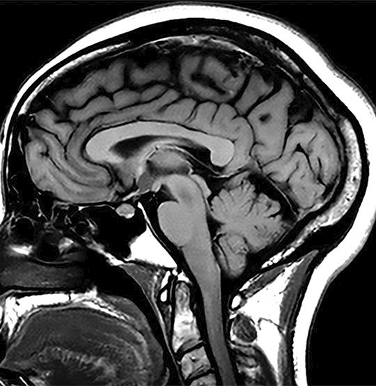
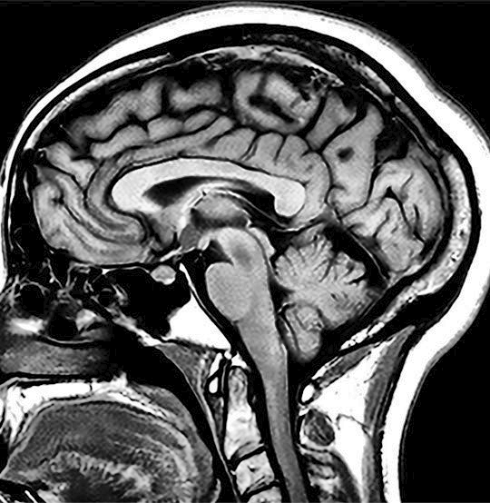
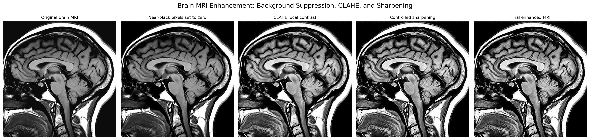
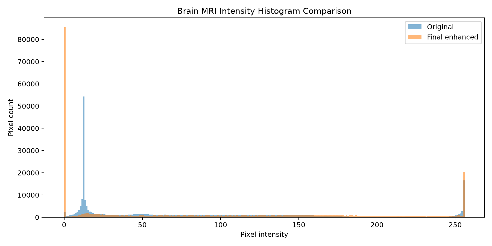
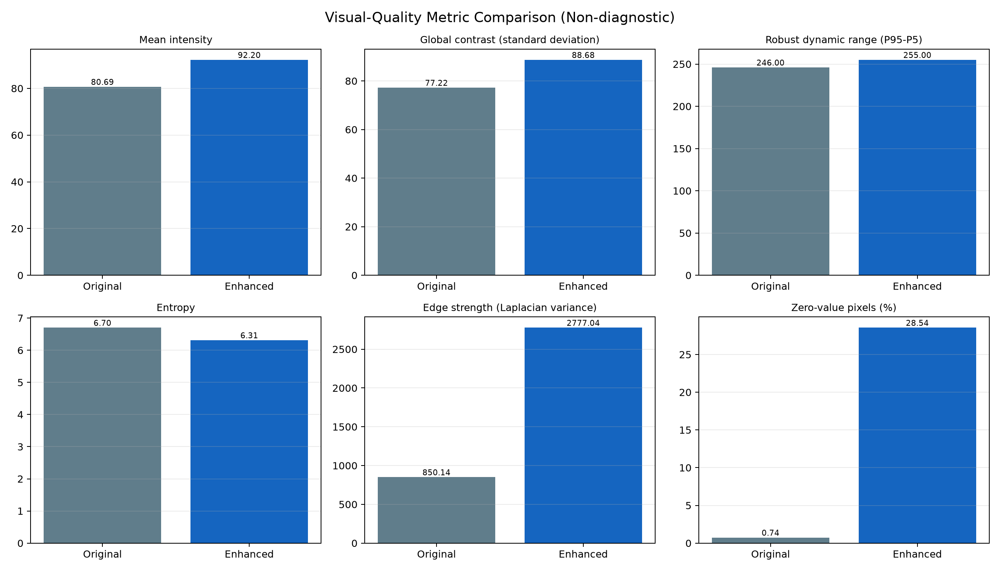

# 🧠 Brain MRI Contrast Enhancement

> A compact digital image-processing project for improving the visual presentation of 2D brain MRI images using **background suppression**, **CLAHE contrast enhancement**, and **controlled sharpening**.


## ✨ Pipeline

```text
Upload brain MRI
       ↓
Set near-black pixels to exact black (0)
       ↓
CLAHE: local contrast enhancement
       ↓
Controlled unsharp-mask sharpening
       ↓
Visual comparison, metrics, and downloadable results
```

This project intentionally uses **no denoising, contour extraction, edge-map output, machine learning, classification, or diagnosis**. The purpose is a clear, explainable image-enhancement workflow that does not blur fine image details through smoothing.

## 🖼️ Processing showcase

The figures below were generated from the included brain MRI test image, `brain_mri_ai_enhanced_input.jpg`.

| Original MRI | Near-black background suppression |
| --- | --- |
|  |  |

| CLAHE local contrast | Controlled sharpening |
| --- | --- |
|  |  |

### Final enhanced MRI


### All stages side by side



## 📊 Visual-quality metrics

These values compare the original showcase image with its final enhanced version. They quantify visual changes only; they are **not clinical validation or diagnostic metrics**.

| Metric | Original | Enhanced | Change | Interpretation |
| --- | ---: | ---: | ---: | --- |
| Mean intensity | 80.69 | 92.20 | +11.51 | Brighter overall intensity distribution |
| Global contrast (standard deviation) | 77.22 | 88.68 | +11.46 | Greater tonal separation |
| Robust dynamic range (P95 − P5) | 246.00 | 255.00 | +9.00 | Wider useful intensity span |
| Entropy | 6.70 | 6.31 | −0.39 | Describes intensity-distribution complexity; it is not a standalone quality score |
| Edge strength (Laplacian variance) | 850.14 | 2777.04 | +1926.90 | Stronger visible local transitions after sharpening |
| Zero-value pixels | 0.74% | 28.54% | +27.81% | Near-black background was set to exact black |

| Intensity histogram | Quality-metric chart |
| --- | --- |
|  |  |

Download the full numeric table here: [brain_mri_quality_metrics.csv](output_images/brain_mri_quality_metrics.csv)

## 🚀 Run the upload application

Open Terminal and run:

```bash
cd /Users/tharun/Desktop/MRI
source .venv/bin/activate
streamlit run app.py
```

Your browser will open at **http://localhost:8501**.

1. Upload a `.png`, `.jpg`, `.jpeg`, `.bmp`, `.tif`, or `.tiff` MRI image.
2. Set the near-black threshold, if necessary. The default is `12`.
3. Click **Process image**.
4. Review each stage, the histogram, and the visual-quality metrics.
5. Download the enhanced PNG and metrics CSV.

The newest browser upload is retained locally in `output_images/latest_upload/` with descriptive filenames.

## 🧪 Command-line processing

To reproduce the showcase result:

```bash
python src/main.py --input input_images/brain_mri_ai_enhanced_input.jpg
```

To process any other MRI image:

```bash
python src/main.py --input /absolute/path/to/your_mri_image.png --black-threshold 12
```

## 🔬 Methods

### 1. Near-black intensity suppression

Pixels at or below the selected threshold are set to `0`. The same mask is reapplied after CLAHE and sharpening, preventing the dark background from becoming gray after enhancement.

### 2. CLAHE local contrast enhancement

Contrast Limited Adaptive Histogram Equalization improves local contrast in small image regions while limiting excessive contrast amplification.

### 3. Controlled sharpening

Unsharp masking emphasizes local visible transitions after CLAHE. The project has no denoising stage, avoiding intentional blur of fine structures.

## 📁 Project layout

```text
MRI/
├── app.py                                  # Streamlit upload interface
├── input_images/
│   └── brain_mri_ai_enhanced_input.jpg     # Showcase MRI input
├── output_images/
│   ├── brain_mri_original.png
│   ├── brain_mri_black_background.png
│   ├── brain_mri_clahe_contrast.png
│   ├── brain_mri_sharpened.png
│   ├── brain_mri_final_enhanced.png
│   ├── brain_mri_processing_comparison.png
│   ├── brain_mri_histogram_comparison.png
│   ├── brain_mri_quality_metrics.png
│   └── brain_mri_quality_metrics.csv
├── src/
│   ├── main.py                             # Command-line processing pipeline
│   ├── enhancement.py                      # Enhancement algorithms
│   └── analysis.py                         # Metrics, charts, and CSV output
├── requirements.txt
└── report_notes.md
```

## ⚠️ Important limitation

This is an educational image-enhancement application only. It does **not** detect, classify, segment, or diagnose medical conditions, and it must not be used for clinical decision-making.
